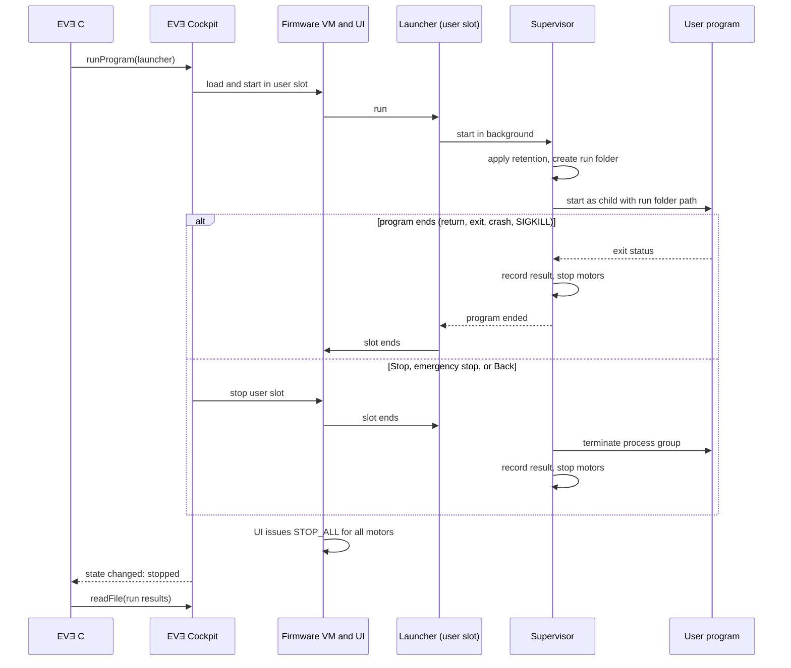

# Program Run Contract - Plan

## Goal Capsule

- **Objective:** A student can build a simple C program in EVƎ C, put it on an EV3 brick running the original LEGO firmware, start and stop it from VS Code or from the brick, and afterwards see how it ended. The robot's motors stop whenever the program ends, however it ends.
- **Product authority:** This plan covers v1 of the EVƎ C core: build, launcher, supervisor, upload, run and stop, run results, and run-folder housekeeping. Returning program-created files is defined here and built after v1. The EVƎ C CLI, brick chains, and multi-robot projects are not active scope.
- **Open blockers:** None for planning. Implementation starts with a brick spike (see Dependencies / Assumptions); if the spike shows the launcher cannot stay alive without starving the VM, the launcher choice reopens.

---

## Product Contract

### Summary

EVƎ C v1 builds a C program with ev3lib, generates a launcher (`.rbf`), ships a small native supervisor, and uploads all three into the project folder through EVƎ Cockpit.
The launcher keeps the brick's user slot alive exactly as long as the program runs, so the brick, the cockpit, and EVƎ C agree on whether it runs, and Stop works in cockpit's safe mode.
Each run leaves a run folder on the brick recording how the program ended and what it printed, and EVƎ C reads it back.

### Problem Frame

Native code on the original EV3 firmware is usually started the ev3duder way: a tiny `.rbf` whose bytecode hands a shell command to the firmware's `opSYSTEM`, starts the binary in the background, waits one second, and ends.
After that second nothing connects the running binary to the brick's program slot.
The brick and the cockpit report "not running" while the robot drives, cockpit's Stop has nothing to stop, and killing the process needs a shell, which cockpit allows only in full mode.

The launcher cannot simply wait for the program either.
`opSYSTEM` is a blocking `system()` followed by `sync()`, and the VM serves USB, Bluetooth, buttons, and the display in the same loop that executes bytecode, so a waiting launcher makes the brick deaf for the whole run.

Motor safety follows from the same gap.
The firmware stops all motors only when the user slot ends: its UI program watches the slot and issues `STOP_ALL` on the transition to stopped.
A detached binary that crashes leaves the motors at their last power, and library cleanup hooks such as `atexit` do not run on `SIGSEGV` or `SIGKILL`.
The author also never learns the exit code, the crash signal, or what the program printed.

For a child moving on from Blockly, a robot that keeps driving after the program "ended" and gives no feedback works against learning.

### Actors

- A1. Program author (student or teacher), working in VS Code; later also through a CLI.
- A2. EVƎ C: the VS Code extension and its build core.
- A3. EVƎ Cockpit: owns the brick connection and exposes upload, read, remove, run, stop, and emergency stop.
- A4. Brick firmware: the VM that runs the launcher in the user slot, and the UI program that stops motors when that slot ends.
- A5. Launcher: the generated `.rbf` running in the user slot.
- A6. Supervisor and user program: native processes; the supervisor ships with EVƎ C, the user program is linked with ev3lib.

### Key Decisions

- **Upload, run, and stop go only through EVƎ Cockpit's API; EVƎ C has no transport of its own.** (session-settled: user-directed — chosen over an own transport: cockpit owns the bricks and their connections.) Governs R6, R7.
- **The launcher keeps the slot alive and starts the program through a native supervisor.** (session-settled: user-directed — chosen over a slot keeper with a watchdog inside ev3lib and over the ev3duder-style thin launcher: the supervisor also stops frozen programs and programs without ev3lib, and it captures exit status and output.) Governs R3, R4, R5, R9, R10.
- **Motor stop relies on the firmware's own slot-end stop plus one more stop by the supervisor.** The firmware already brakes or floats all motors when the user slot ends; the supervisor closes the window in which the program could restart them. Governs R10, R11.
- **The launcher manages only its own program inside its own project folder.** (session-settled: user-approved — chosen over a general-purpose launcher: keeps cockpit's safe-mode intent without full mode or `runShell`.) Governs R4, R16.
- **Stop is as fast as the brick allows, with no latency guarantee.** (session-settled: user-directed — chosen over a stop-time guarantee: stopping is in the brick's hands; EVƎ C only signals.) Governs R7, R10.
- **Back follows the firmware default, and a program may take Back over through ev3lib.** (session-settled: user-directed — chosen over Back always owned by the firmware or always by the program.) Governs R12.
- **Run folders are named by an increasing run number, not by brick time.** The brick likely has no battery-backed clock; EVƎ C records the wall-clock start time on the PC. (session-settled: user-approved — chosen over date-and-time folder names.) Governs R13, R14.
- **Run-folder retention is a build-time rule that the supervisor applies before each run, plus explicit cleanup commands in EVƎ C.** (session-settled: user-directed — chosen over unbounded run folders.) Governs R15, R16, R17.
- **Returning program-created files is defined now and built after v1.** (session-settled: user-approved — chosen over building it in v1 and over manual download only.) Governs R18.
- **The build core, launcher generation, and supervisor packaging do not depend on VS Code.** A later EVƎ C CLI reuses them over the cockpit CLI and daemon. Governs R2.

### Requirements

**Build**

- R1. EVƎ C builds a simple C program linked with ev3lib into an ARM executable that runs on the EV3's original LEGO firmware.
- R2. Building, launcher generation, and supervisor packaging can run as a plain process without VS Code.

**Launcher and supervisor**

- R3. EVƎ C generates a launcher `.rbf` for each program; the launcher can be started from the brick's file menu and through cockpit's `runProgram`.
- R4. The launcher starts the supervisor in the background and stays in the user slot until the program has ended, without blocking the VM while it waits; it changes permissions only on its own project files and touches nothing outside the project folder.
- R5. The supervisor starts the user program as its child process and passes it the path of the current run folder.
- R6. EVƎ C uploads the program, the launcher, and the supervisor into the project folder under `/home/root/lms2012/prjs/` through cockpit's `writeFile`, with every brick path shorter than 60 bytes, and recovers from a failed upload by uploading again.

**Run and stop**

- R7. EVƎ C exposes Run, Stop, and Emergency Stop as commands that call cockpit's `runProgram`, `stopProgram`, and `emergencyStop`, and adds no stop mechanism of its own.
- R8. The run state EVƎ C shows is the user-slot state cockpit reports, and that state is "running" exactly while the user program is alive.
- R9. When the user program ends for any reason (return from `main`, `exit`, a crash signal, or `SIGKILL`), the supervisor records how it ended and the launcher then ends the slot.
- R10. When the slot ends for any reason (cockpit Stop, emergency stop, Back, or the launcher ending), the supervisor terminates the program's whole process group as soon as it notices.
- R11. After the program is gone, the supervisor stops all motors once more before it exits.
- R12. Back stops the program by default; a program may block Back through ev3lib and handle the press itself.

**Run results and run folders**

- R13. Each run gets a new run folder inside the project's runs folder on the brick, named by an increasing run number.
- R14. The supervisor writes the program's exit code or terminating signal and its stdout and stderr into the run folder; after the run ends, EVƎ C reads them and shows them to the author together with the PC-side start time.
- R15. The build embeds a retention rule, either "keep the last N runs" or "keep runs up to M megabytes", and the supervisor applies it before it creates the new run folder.
- R16. Retention and cleanup delete only that project's run folders and never the folder of a program that is running.
- R17. EVƎ C offers commands that delete a project's run folders, either all of them or all but the last N, through cockpit's `remove`.
- R18. The run-folder layout reserves a place for a list of files the program marks for return (see Defined for After v1).

### Key Flows

- F1. Build and upload
  - **Trigger:** The author runs `EV3 C: Build` or an upload command.
  - **Steps:** EVƎ C builds the executable, generates the launcher with the retention rule, and uploads program, launcher, and supervisor into the project folder through cockpit.
  - **Outcome:** The launcher appears in the brick's file menu.
  - **Covered by:** R1, R2, R3, R6, R15
- F2. Run to a normal end
  - **Trigger:** The author starts the program from EVƎ C or from the brick menu.
  - **Steps:** The launcher starts in the user slot and starts the supervisor; the supervisor applies retention, creates the run folder, and starts the program; the program ends; the supervisor records the result; the launcher ends the slot; the firmware stops the motors; cockpit reports "stopped"; EVƎ C reads the run results.
  - **Outcome:** The author sees the exit code and output.
  - **Covered by:** R4, R5, R8, R9, R13, R14, R15
- F3. Stop
  - **Trigger:** Stop or Emergency Stop in EVƎ C, or Back on the brick.
  - **Steps:** The user slot ends; the firmware stops the motors; the supervisor notices, terminates the program's process group, stops the motors again, and records the result.
  - **Outcome:** The program is gone, the motors stay stopped, and the run results show the program was stopped.
  - **Covered by:** R7, R10, R11, R12, R14
- F4. Crash
  - **Trigger:** The program dies on a signal.
  - **Steps:** The supervisor records the signal; the launcher ends the slot; the firmware stops the motors.
  - **Outcome:** The run results show the crash signal.
  - **Covered by:** R9, R11, R14

### Acceptance Examples

- AE1. **Covers R8, R9, R14.** Given a program that starts a motor and then dereferences a null pointer, when it crashes, then the motor stops, cockpit and EVƎ C show "not running", and the run results show the crash signal.
- AE2. **Covers R7, R10, R11.** Given a program in an endless loop that keeps setting motor power and cockpit in safe mode, when the author presses Stop in EVƎ C, then the program ends, the motors stay stopped, and no shell command or full mode was needed.
- AE3. **Covers R12.** Given a program that did not take over Back, when Back is pressed, then the program stops as in AE2. Given a program that took over Back, when Back is pressed, then the program receives the press and keeps running.
- AE4. **Covers R15, R16.** Given the rule "keep the last 5 runs" and five existing run folders, when a new run starts, then the oldest run folder is deleted before the new one appears, and nothing outside the project's runs folder changes.
- AE5. **Covers R16, R17.** Given a running program, when the author deletes all runs of the project, then every run folder except the running program's own folder is deleted.

### Success Criteria

- v1 is accepted on a real brick in cockpit's safe mode, not only against the cockpit mock: F1 to F4 and AE1 to AE5 pass on hardware.

### Defined for After v1

Returning files the program creates, in the shape agreed for the run folder (R18):

- ev3lib lets a program create a file marked "return"; files created without the mark are not tracked.
- ev3lib adds each marked file's full path to the run folder's list at the moment the file is created, so the list survives a crash.
- After the run ends, EVƎ C (and later the CLI) reads the list and downloads the listed files into the local workspace for viewing.
- Independently of the mark, an author can download any brick file by path.

### Scope Boundaries

**Deferred for later**

- Returning program-created files, as defined above.
- Live program output while the program runs; v1 reads output after the run ends.
- The EVƎ C CLI, which will drive the cockpit CLI or daemon and reuse the core from R2.
- Brick chains (daisy chain, Bluetooth) and projects with several robots and shared libraries.
- A program that outlives a crashed supervisor; the firmware still stops the motors when the slot ends, and v1 accepts the orphaned process as a residual risk.

**Outside this product's identity**

- EVƎ C implements no brick transport and does not modify the firmware.

### Dependencies / Assumptions

- EVƎ Cockpit API v1 provides `writeFile`, `readFile`, `exists`, `makeDirectory`, `remove`, `runProgram`, `stopProgram`, `emergencyStop`, and `onProgramStateChanged`; safe mode allows writing, deleting, and running only under `/home/root/lms2012/prjs` and `/media/card`; `runShell` needs full mode.
- Cockpit's `readFile` is meant for small files at most once per second, which is enough for v1 run results; downloading larger returned files after v1 depends on agreeing limits with cockpit.
- Cockpit runs programs in the user slot, `stopProgram` stops the user slot, and `emergencyStop` also issues `STOP_ALL`.
- Firmware behavior below was read from LEGO's published EV3 firmware sources (developer edition 1.09) and is assumed to hold for the retail firmware: `opSYSTEM` is enabled and blocking, the VM serves communication in its bytecode loop, the UI program stops all motors when the user slot ends, a slot's open files are closed when it ends, and the VM does not ignore `SIGPIPE`.
- To verify in the brick spike: uploaded files arrive without execute permission and the launcher can set it; `/tmp` is in RAM; the brick has no battery-backed clock; the launcher's polling loop leaves the VM responsive; the firmware UI does not draw over the program's display output while the user slot runs.

### Outstanding Questions

**Deferred to Planning**

- How the supervisor notices that the slot has ended: a heartbeat file in RAM, end-of-file on a pipe the launcher holds open, or another signal. The pipe variant risks blocking the VM on open and killing it with `SIGPIPE`.
- How the launcher learns that the program has ended (a marker the supervisor removes, `/proc/<pid>`, or a status file) and how often it checks.
- Whether each project carries its own supervisor copy or bricks share one, and how supervisor versions are checked.
- Default retention values and the run-folder layout and result format.
- How EVƎ C's Emergency Stop relates to cockpit's own emergency stop command, so the palette does not offer the same action twice.

### Sources / Research

- LEGO EV3 firmware sources, developer edition 1.09: `lms2012/source/lms2012.c` (`System()` 4622-4635, VM loop 2430-2485, `ProgramEnd` 1604), `lms2012/source/lms2012.h:182`, `lmssrc/ui/ui.lms:165-191`, `c_input/source/c_input.c:402-406`, `c_output/source/c_output.c:254` and `414-423`, `d_pwm/Linuxmod_AM1808/d_pwm.c:2177`, `c_memory/source/c_memory.c:305-320`, `lms2012/source/bytecodes.h`.
- ev3duder `src/mkrbf.c`: the command is copied into the `.rbf` unsanitized (lines 28-35) and followed by a fixed one-second wait trailer (line 19).
- EVƎ Cockpit: `src/protocol/ev3Commands.ts:150-161` and `485-492`, `src/api/cockpitApi.ts`, `docs/api-for-consumers.md:96-108`, `src/fs/filesystemService.ts:31`.
