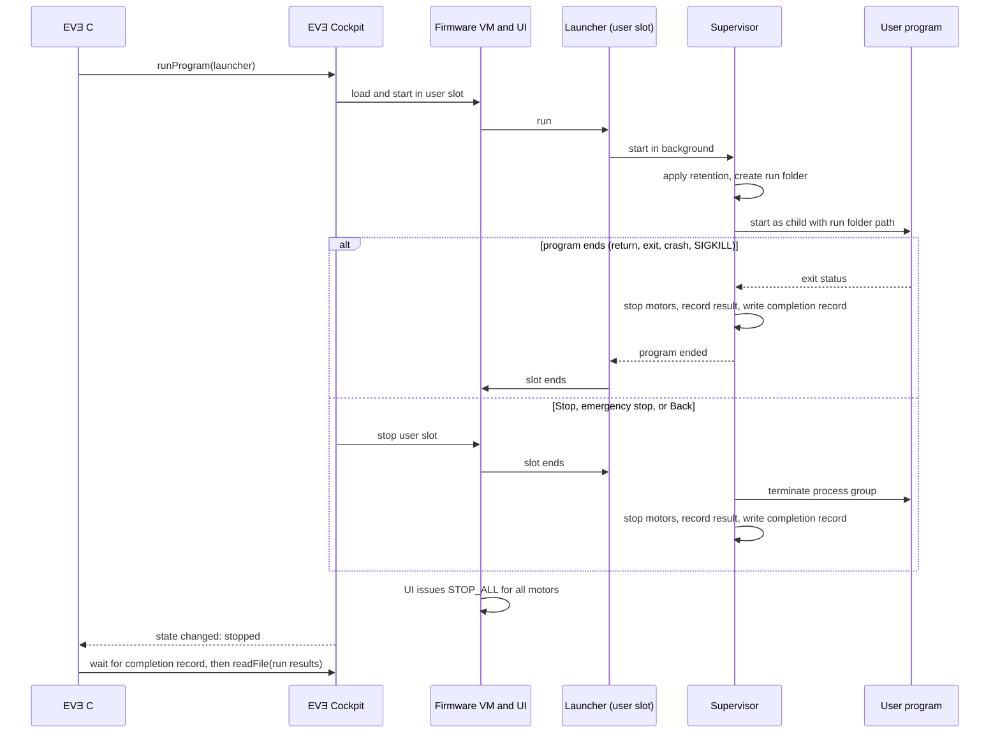
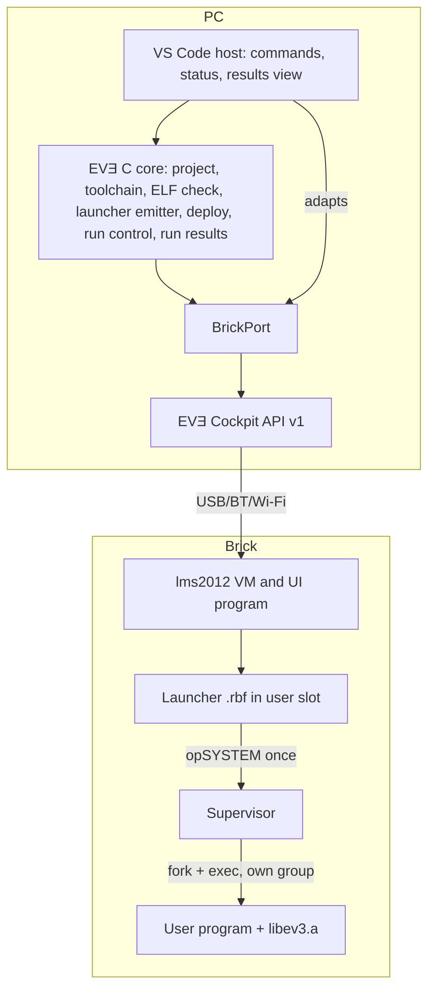
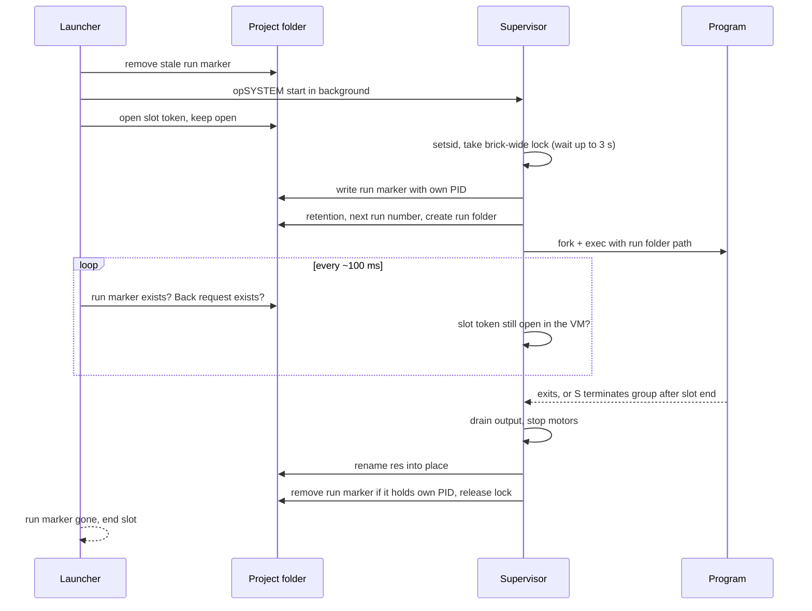
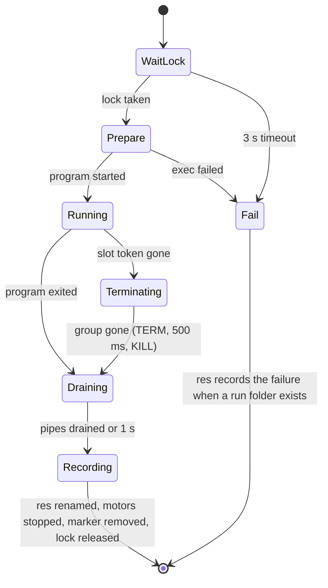
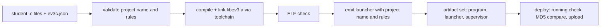

# Program Run Contract - Plan

## Goal Capsule

- **Objective:** A student can build a simple C program in EVƎ C, put it on an EV3 brick running the original LEGO firmware, start and stop it from VS Code or from the brick, and afterwards see how it ended. The robot's motors stop whenever the program ends, however it ends.
- **Means:** a slot-keeping launcher plus a native supervisor, built from a VS Code-free core and driven through EVƎ Cockpit's API v1 (Key Decisions; KTD4–KTD7, KTD10).
- **Product authority:** This plan covers v1 of the EVƎ C core: build, launcher, supervisor, upload, run and stop, run results, and run-folder housekeeping. Returning program-created files is defined here and built after v1. The EVƎ C CLI, brick chains, and multi-robot projects are not active scope.
- **Execution profile:** one PR from a feature branch. U1 (brick spike) runs first; its findings confirm or adjust the KTDs marked "confirm in U1" before U5 and U6 are finished. U1 and U10 need Petr to connect a brick over USB with EVƎ Cockpit 0.2.394 (or master `217b5e2`) and no cockpit tests running on it.
- **Stop conditions:**
  - U1 shows the launcher loop starves the VM (cockpit loses the brick or Stop stops working): stop and return to `ce-brainstorm`, because the launcher choice reopens.
  - U1 shows Zig + musl binaries do not run on the brick: stop and ask Petr which fallback toolchain to build (KTD1); do not adopt the c4ev3 toolchain.
  - U1 shows the project folder lives in RAM until a clean shutdown: record it in the spike findings and user docs, then continue (KTD8).
- **Who finishes:** `ce-work` implements and verifies; Petr runs the hardware acceptance (U10), reviews, and pushes.
- **Open blockers:** none for planning. Hardware access for U1 and U10 is scheduled through Petr.

---

## Product Contract

### Summary

EVƎ C v1 builds a C program with ev3lib, generates a launcher (`.rbf`), ships a small native supervisor, and uploads all three into the project folder through EVƎ Cockpit.
The launcher keeps the brick's user slot alive while the program runs and ends it when the program ends, so the brick, the cockpit, and EVƎ C agree on whether it runs, and Stop works in cockpit's safe mode.
Each run leaves a run folder on the brick recording how the program ended and what it printed, and EVƎ C reads it back.

### Problem Frame

Native code on the original EV3 firmware is usually started the ev3duder way: a tiny `.rbf` whose bytecode hands a shell command to the firmware's `opSYSTEM`, starts the binary in the background, waits one second, and ends.
After that second nothing connects the running binary to the brick's user slot.
The brick and the cockpit report "not running" while the robot drives, cockpit's Stop has nothing to stop, and killing the process needs a shell, which cockpit allows only in full mode.

The launcher cannot simply wait for the program either.
`opSYSTEM` is a blocking `system()` followed by `sync()`, and the VM serves USB, Bluetooth, buttons, and the display in the same loop that executes bytecode, so a waiting launcher makes the brick deaf for the whole run.

Motor safety follows from the same gap.
The firmware stops all motors only when the user slot ends: its UI program watches the slot and issues `STOP_ALL` on the transition to stopped.
A detached binary that crashes leaves the motors at their last power, and library cleanup hooks such as `atexit` do not run on `SIGSEGV` or `SIGKILL`.
The author also never learns the exit code, the crash signal, or what the program printed.

For a child moving on from Blockly, a robot that keeps driving after the program "ended" and gives no feedback works against learning.

### Actors

- A1. Program author (student or teacher), working in VS Code; later also through a CLI.
- A2. EVƎ C: the VS Code extension and its build core.
- A3. EVƎ Cockpit: owns the brick connection and exposes upload, read, list, remove, run, stop, and emergency stop.
- A4. Brick firmware: the VM that runs the launcher in the user slot, and the UI program that stops motors when that slot ends.
- A5. Launcher: the generated `.rbf` running in the user slot.
- A6. Supervisor and user program: native processes; the supervisor ships with EVƎ C, the user program is linked with ev3lib.

### Key Decisions

- **Upload, run, and stop go only through EVƎ Cockpit's API; EVƎ C has no transport of its own.** (session-settled: user-directed — chosen over an own transport: cockpit owns the bricks and their connections.) Governs R6, R7.
- **The launcher keeps the slot alive and starts the program through a native supervisor.** (session-settled: user-directed — chosen over a slot keeper with a watchdog inside ev3lib and over the ev3duder-style thin launcher: the supervisor also stops frozen programs and programs without ev3lib, and it captures exit status and output.) Governs R3, R4, R5, R9, R10.
- **Motor stop relies on the firmware's own slot-end stop plus one more stop by the supervisor.** The firmware already brakes or floats all motors when the user slot ends; the supervisor closes the window in which the program could restart them. Governs R10, R11.
- **The launcher manages only its own program inside its own project folder.** (session-settled: user-approved — chosen over a general-purpose launcher: keeps cockpit's safe-mode intent without full mode or `runShell`.) Governs R4, R16.
- **Stop is as fast as the brick allows, with no latency guarantee.** (session-settled: user-directed — chosen over a stop-time guarantee: stopping is in the brick's hands; EVƎ C only signals.) Governs R7, R10.
- **Back follows the firmware default, and a program may take Back over through ev3lib.** (session-settled: user-directed — chosen over Back always owned by the firmware or always by the program.) Governs R12.
- **Run folders are named by an increasing run number, not by brick time.** The brick likely has no battery-backed clock; EVƎ C records the wall-clock start time on the PC. (session-settled: user-approved — chosen over date-and-time folder names.) Governs R13, R14.
- **Run-folder retention is a build-time rule that the supervisor applies before each run, plus explicit cleanup commands in EVƎ C.** (session-settled: user-directed — chosen over unbounded run folders.) Governs R15, R16, R17.
- **Returning program-created files is defined now and built after v1.** (session-settled: user-approved — chosen over building it in v1 and over manual download only.) Governs R18.
- **The build core, launcher generation, and supervisor packaging do not depend on VS Code.** A later EVƎ C CLI reuses them over the cockpit CLI and daemon. Governs R2.
- **Project names are short.** Cockpit refuses brick paths of 60 bytes or more, and the launcher path repeats the project name. (session-settled: user-approved — chosen over free-form names: every path must fit the cockpit limit.) Governs R23.
- **EVƎ C does not upload over a running program.** Overwriting a running binary fails on the brick or leaves it truncated. (session-settled: user-approved — chosen over uploading regardless.) Governs R24.

### Requirements

**Build**

- R1. EVƎ C builds a simple C program linked with ev3lib into an ARM executable that runs on the EV3's original LEGO firmware.
- R2. Building, launcher generation, and supervisor packaging can run as a plain process without VS Code.
- R23. A project name is at most 15 bytes of lowercase ASCII letters, digits, `-`, or `_`, and EVƎ C rejects any other name before building.

**Launcher and supervisor**

- R3. EVƎ C generates a launcher `.rbf` for each program; the launcher can be started from the brick's file menu and through cockpit's `runProgram`.
- R4. The launcher starts the supervisor in the background and stays in the user slot until the program has ended, without blocking the VM while it waits; it changes permissions only on its own project files and touches nothing outside the project folder.
- R5. The supervisor starts the user program as its child process and passes it the path of the current run folder.
- R6. EVƎ C uploads the program, the launcher, and the supervisor into the project folder under `/home/root/lms2012/prjs/` through cockpit's `writeFile`, and recovers from a failed upload by uploading again; every brick path EVƎ C passes to cockpit, including run-folder files it reads or removes, is shorter than 60 bytes.

**Run and stop**

- R7. EVƎ C exposes Run, Stop, and Emergency Stop as commands that call cockpit's `runProgram`, `stopProgram`, and `emergencyStop`, and adds no stop mechanism of its own.
- R8. The run state EVƎ C shows is the user-slot state cockpit reports: "running" from the launcher's start until the slot ends, which happens only after the program has ended (R9) or the slot was stopped (R10), so it can lag the program's real start and end by the launcher's and supervisor's detection delay.
- R9. When the user program ends for any reason (return from `main`, `exit`, a crash signal, or `SIGKILL`), the supervisor records how it ended and the launcher then ends the slot.
- R10. When the slot ends for any reason (cockpit Stop, emergency stop, Back, or the launcher ending), the supervisor terminates the program's whole process group as soon as it notices.
- R11. After the program is gone, the supervisor stops all motors once more before it exits.
- R12. Back stops the program by default. A program may take over short presses of Back through ev3lib: ev3lib requests the block and the launcher applies it, because only bytecode in the user slot can block Back. A long press of Back always stops the program.
- R24. EVƎ C refuses to upload a project while a program is running on the brick and asks the author to stop it first.

**Run results and run folders**

- R13. Each run gets a new run folder inside the project's runs folder on the brick, named by an increasing run number.
- R14. The supervisor writes the program's exit code or terminating signal and its stdout and stderr into the run folder, and writes a completion record as its very last step. After the slot stops, EVƎ C waits for that record within cockpit's read rate, then shows the results to the author with the PC-side start time, or reports that no result was recorded if the record never appears.
- R15. The build embeds a retention rule, either "keep the last N runs" or "keep runs up to M megabytes", and the supervisor applies it before it creates the new run folder.
- R16. Retention and cleanup delete only that project's run folders and never the folder of a program that is running.
- R17. EVƎ C offers commands that delete a project's run folders, either all of them or all but the last N, through cockpit's `remove`.
- R18. The run-folder layout reserves a place for a list of files the program marks for return (see Defined for After v1).
- R19. The supervisor caps each captured output stream at a size limit embedded at build time next to the retention rule, and the run result says when output was truncated.
- R20. ev3lib switches the program's stdout and stderr to line-by-line writing before `main` runs, so output printed before a crash or a stop reaches the run folder.
- R21. EVƎ C lists the project's run folders on the brick and shows the results of any listed run, including runs started from the brick menu; a run EVƎ C did not observe is shown by its run number without a PC-side start time.
- R22. The run number comes from a per-project counter kept outside the run folders, so retention and cleanup never cause a number to be reused.



### Key Flows

- F1. Build and upload
  - **Trigger:** The author runs `EV3 C: Build` or an upload command.
  - **Steps:** EVƎ C builds the executable, generates the launcher with the retention rule, and uploads program, launcher, and supervisor into the project folder through cockpit.
  - **Outcome:** The launcher appears in the brick's file menu.
  - **Covered by:** R1, R2, R3, R6, R15, R23, R24
- F2. Run to a normal end
  - **Trigger:** The author starts the program from EVƎ C or from the brick menu.
  - **Steps:** The launcher starts in the user slot and starts the supervisor; the supervisor applies retention, creates the run folder, and starts the program; the program ends; the supervisor stops the motors and records the result; the launcher ends the slot; the firmware stops the motors; cockpit reports "stopped"; EVƎ C reads the run results.
  - **Outcome:** The author sees the exit code and output.
  - **Covered by:** R4, R5, R8, R9, R11, R13, R14, R15
- F3. Stop
  - **Trigger:** Stop or Emergency Stop in EVƎ C, or Back on the brick.
  - **Steps:** The user slot ends; the firmware stops the motors; the supervisor notices, terminates the program's process group, stops the motors again, and records the result.
  - **Outcome:** The program is gone, the motors stay stopped, and the run results show the program was stopped.
  - **Covered by:** R7, R10, R11, R12, R14
- F4. Crash
  - **Trigger:** The program dies on a signal.
  - **Steps:** The supervisor stops the motors and records the signal; the launcher ends the slot; the firmware stops the motors.
  - **Outcome:** The run results show the crash signal.
  - **Covered by:** R9, R11, R14

### Acceptance Examples

- AE1. **Covers R8, R9, R11, R14, R20.** Given a program that starts a motor, prints a line, and then dereferences a null pointer, when it crashes, then the motor stops, cockpit and EVƎ C show "not running", and the run results show the printed line and the crash signal.
- AE2. **Covers R7, R10, R11.** Given a program in an endless loop that keeps setting motor power and cockpit in safe mode, when the author presses Stop in EVƎ C, then the program ends, the motors stay stopped, and no shell command or full mode was needed.
- AE3. **Covers R12.** Given a program that did not take over Back, when Back is pressed, then the program stops as in AE2. Given a program that took over Back, when Back is pressed briefly, then the program receives the press and keeps running; when Back is held, then the program stops.
- AE4. **Covers R15, R16.** Given the rule "keep the last 5 runs" and five existing run folders, when a new run starts, then the oldest run folder is deleted before the new one appears, and nothing outside the project's runs folder changes.
- AE5. **Covers R16, R17.** Given a running program, when the author deletes all runs of the project, then every run folder except the running program's own folder is deleted.
- AE6. **Covers R21, R22.** Given a program started from the brick menu while EVƎ C is disconnected, when EVƎ C reconnects and the author lists the project's runs, then that run appears with its run number, its result, and no PC-side start time.
- AE7. **Covers R19.** Given a program that prints in an endless loop, when it is stopped, then its captured output is no larger than the build-time limit and the run result says the output was truncated.

### Success Criteria

- v1 is accepted on a real brick in cockpit's safe mode, not only against the cockpit mock: F1 to F4 and AE1 to AE7 pass on hardware.

### Defined for After v1

Returning files the program creates, in the shape agreed for the run folder (R18):

- ev3lib lets a program create a file marked "return"; files created without the mark are not tracked.
- ev3lib adds each marked file's full path to the run folder's list at the moment the file is created, so the list survives a crash.
- After the run ends, EVƎ C (and later the CLI) reads the list and downloads the listed files into the local workspace for viewing.
- Independently of the mark, an author can download any brick file by path.

### Scope Boundaries

**Deferred for later**

- Returning program-created files, as defined above.
- Live program output while the program runs; v1 reads output after the run ends.
- The EVƎ C CLI, which will drive the cockpit CLI or daemon and reuse the core from R2.
- Brick chains (daisy chain, Bluetooth) and projects with several robots and shared libraries.
- The full ev3lib API from the design notes; v1 ships only the surface the contract and its acceptance examples need (KTD14).
- A program that outlives a crashed supervisor; the firmware still stops the motors when the slot ends, and v1 accepts the orphaned process as a residual risk.

**Outside this product's identity**

- EVƎ C implements no brick transport and does not modify the firmware.

**Considered and not built**

- Working around a project folder that lives in RAM until a clean shutdown (for example forcing a flush after upload). If U1 confirms it, it is a firmware property and v1 documents it; evidence that students lose work in practice would change the call.
- A supervisor-liveness check in the launcher. If the supervisor itself dies, the slot stays "running" until the author presses Stop or Back, which still works; a field report of stuck slots would change the call.
- Dynamic linking against an ev3lib installed on the brick. Static binaries are small enough with musl, and dynamic linking would tie every program to a brick-side library version.

### Dependencies / Assumptions

- EVƎ Cockpit API v1 provides `writeFile`, `readFile`, `list`, `exists`, `makeDirectory`, `remove`, `runProgram`, `stopProgram`, `emergencyStop`, `isProgramRunning`, and `onProgramStateChanged`; safe mode allows writing, deleting, and running only under `/home/root/lms2012/prjs` and `/media/card`; `runShell` needs full mode and returns only the `system()` status, not the command's output.
- Cockpit's `readFile` is meant for small files at most once per second, which is enough for v1 run results; downloading larger returned files after v1 depends on agreeing limits with cockpit.
- Cockpit's recursive `remove` deletes only one folder level on the brick and reports no failure, so run folders stay flat and EVƎ C lists again after deleting.
- Cockpit runs programs in the user slot, `stopProgram` stops the user slot, and `emergencyStop` also issues `STOP_ALL`. Cockpit's mock simulates run state only: it never executes a program and truncates binary uploads.
- Firmware behavior below was read from LEGO's published EV3 firmware sources (developer edition 1.09) and is assumed to hold for the retail firmware: `opSYSTEM` is enabled and blocking, the VM serves communication in its bytecode loop, the UI program stops all motors when the user slot ends, a slot's open files are closed when it ends, every bytecode file close runs a global `sync()`, uploads through cockpit end with the file made executable, and the VM does not ignore `SIGPIPE`.
- To verify in the brick spike (U1): the brick's libc and kernel versions, that uploaded files are executable, whether `/tmp` and the project folder are in RAM, that the brick has no battery-backed clock, that the launcher's polling loop leaves the VM responsive, how a background child of `opSYSTEM` sits in the process tree, and whether the firmware UI draws over the program's display output.

### Sources / Research

- LEGO EV3 firmware sources, developer edition 1.09: `lms2012/source/lms2012.c` (`System()` 4622-4635, VM loop 2430-2485, `ProgramEnd` 1604), `lms2012/source/lms2012.h:182`, `lmssrc/ui/ui.lms:165-191`, `c_input/source/c_input.c:402-406`, `c_output/source/c_output.c:254` and `414-423`, `d_pwm/Linuxmod_AM1808/d_pwm.c:2177`, `c_memory/source/c_memory.c:305-321` and `931-961`, `c_com/source/c_com.c:1115` and `1236`, `lms2012/source/bytecodes.h`, `lms2012/source/lmstypes.h:137-182`.
- ev3duder `src/mkrbf.c`: the command is copied into the `.rbf` unsanitized (lines 28-35) and followed by a fixed one-second wait trailer (line 19).
- EVƎ Cockpit: `src/protocol/ev3Commands.ts:150-161` and `485-492`, `src/api/cockpitApi.ts`, `docs/api-for-consumers.md:96-108`, `src/fs/filesystemService.ts:31`, `src/programs/programService.ts`, `scripts/api-check/extension.js`.
- c4ev3 toolchain notes (https://github.com/c4ev3/C4EV3.Toolchain, https://c4ev3.github.io/): the stock firmware ships glibc 2.8 and kernel 2.6.33, and Debian/Linaro toolchains fail against it.
- Zig glibc and musl targets: https://raw.githubusercontent.com/ziglang/zig/master/lib/libc/glibc/README.md.

---

## Planning Contract

**Product Contract preservation:** changed: R23 and R24 added, with their Key Decisions, from call-outs the user approved at plan time. Outstanding Questions were resolved into KTDs below. Dependencies / Assumptions, Scope Boundaries, and Sources were updated with research findings. No other requirement changed.

### Key Technical Decisions

- KTD1. **Programs and the supervisor are static ARMv5TE soft-float binaries with their own libc, built first with Zig and musl.** The brick ships glibc 2.8 on kernel 2.6.33, so options A and B from the design notes (ARM GNU Toolchain, Debian `gcc-arm-linux-gnueabi`) produce binaries that cannot run there. Zig is one host-portable binary for Windows, Linux, and macOS. U1 confirms that musl binaries run on the brick. (session-settled: user-directed — chosen over the c4ev3 prebuilt toolchain as a fallback: if Zig fails, Petr decides after U1 and prefers building an own toolchain; WSL is acceptable.) Governs R1.
- KTD2. **The compiler is downloaded on first build from a pinned manifest, not bundled.** The manifest holds one entry per host (URL, SHA-256, archive layout, target flags) and points at a mirror in the project's own GitHub releases. The archive is cached in the extension's global storage, a setting overrides the compiler path, and a "check toolchain" command reports what is in use. Bundling would make the compiler the whole VSIX.
- KTD3. **Every build checks the produced ELF itself.** A small TypeScript reader verifies ARM, ARMv5TE, soft-float (no VFP attributes), static (no interpreter and no `NEEDED` entries), and refuses anything else. `readelf` is not available on Windows, and a toolchain that silently emits ARMv7 or hard-float would fail only on the brick.
- KTD4. **The supervisor and `libev3.a` are built by CI with the same toolchain and ship inside the VSIX.** The user's build compiles only the student's sources and links `libev3.a`. Both artifacts are small static files, and building them on the student's machine would add a slow first build and a second failure surface.
- KTD5. **The launcher is emitted by a TypeScript bytecode encoder in the core.** One launcher template per program is generated at build time from header, constant, variable, and jump encoders with backpatched labels, using the opcodes in `bytecodes.h`. LEGO's `lmsasm` assembler (GPL, needs Java) is used only at development time to regenerate a golden byte fixture for the template.
- KTD6. **The launcher runs one start, a handshake, and a stat-only poll loop.**
  1. Remove a stale run marker in the project folder, then call `opSYSTEM` once to start the supervisor in the background, passing the project folder obtained from `FILENAME GET_FOLDERNAME`.
  2. Open a slot token file in the project folder once and keep it open for the whole run; never close it.
  3. Wait up to 6 s for the supervisor's run marker to appear; if it never does, end the slot.
  4. Every ~100 ms: test the run marker with `FILENAME EXIST`, and set or clear the Back block with `UI_BUTTON SET_BACK_BLOCK` when ev3lib's Back request marker appears or disappears.
  5. End when the run marker is gone.

  No file is closed inside the loop, because every bytecode close runs a global `sync()`. Confirm the loop cost in U1. Governs R4, R12.
- KTD7. **The supervisor detects slot end through the slot token, without writes.** When the slot ends, the VM closes the token file. The supervisor finds the `lms2012` process once and polls its open file descriptors for the token every ~100 ms. Fallback if U1 disproves it: the launcher appends one byte per tick to the already-open token and the supervisor watches the size stop growing. A FIFO was rejected because opening it blocks the VM and a write without a reader kills the VM with `SIGPIPE`. Confirm in U1. Governs R10.
- KTD8. **The supervisor owns its own process group and a brick-wide run lock.**
  - It calls `setsid()` before forking the program, so killing the group never reaches the VM.
  - It closes inherited descriptors and resets signal dispositions before `exec`.
  - It takes an `flock` on one lock file in `/home/root/lms2012/prjs/` and holds it until its completion record is written. A new supervisor waits up to 3 s for that lock, so the previous run's final motor stop (R11) can never hit the next run, including runs of other projects.
  - It writes its PID into the run marker and, at the end, removes the marker only if it still holds that PID.

  Governs R10, R11.
- KTD9. **Termination is SIGTERM, a 500 ms grace period, then SIGKILL, all to the program's group.** Output pipes are drained with a 1 s deadline. Motors are stopped by writing the firmware's program-stop command to `/dev/lms_pwm`, as the firmware's own stop does. Governs R10, R11.
- KTD10. **The run folder is flat and short, and the completion record is an atomic rename.**
  - Layout: `<project>/run/next` holds the counter, and `<project>/run/<n>/` holds `out`, `err`, and `res`.
  - `res` is written as a temporary file and renamed into place as the supervisor's last write. Its existence is the completion record.
  - `res` is small `key=value` text: exit code or signal, how the run ended (program end or slot end), truncation flags, and the run number.
  - The longest path is 24 + 15 + 5 + 5 + 4 = 53 bytes, and the launcher path `<project>/<project>.rbf` is at most 59.
  - A slot token, a run marker, and a Back request marker live in the project folder under dot-names.

  If U1 shows the project folder is in RAM, the counter can roll back after a power loss; that is accepted with the rest of KTD8's considered-and-not-built item. Governs R13, R14, R18, R22, R23.
- KTD11. **The core talks to the brick only through a narrow `BrickPort` interface.** Build, toolchain, launcher, deploy, run control, and run results take a port plus host-supplied settings and logger, and import nothing from `vscode`. The VS Code layer adapts cockpit's `registerConsumer` handle to the port and keeps its own copy of the cockpit API types with an `apiVersion === 1` check, because cockpit publishes no types package. This mirrors cockpit's own core extraction. Governs R2, R6, R7.
- KTD12. **EVƎ C ties a Run to its run number by reading the counter first.** Before `runProgram`, EVƎ C reads `run/next`. After cockpit reports "stopped", or `runProgram` returns without a running state, or the brick reconnects, it polls `run/<n>/res` at most once per second for up to 10 s. If no record appears, it reports "no result recorded" and leaves the run listed for later. Governs R14, R21.
- KTD13. **Deploy compares MD5 before uploading.** EVƎ C lists the project folder, compares cockpit's per-file MD5 with the local artifacts, and uploads only what differs. That skips the unchanged supervisor and doubles as its version check. Before any upload it asks `isProgramRunning` and refuses if a program runs (R24). Governs R6, R24.
- KTD14. **ev3lib v1 is the minimum the contract needs.** The surface is init and exit, motor power and stop, line-buffered stdio set up before `main`, sleep, and the Back takeover request. A normal exit also stops the motors. Everything else from the design notes waits. Governs R12, R20.
- KTD15. **Retention defaults are "keep the last 10 runs" and a 64 KiB cap per output stream.** The worst case is about 1.3 MB of run folders per project, which fits even the ~6 MB RAM-backed project folder the research suspects, while 64 KiB holds several thousand lines of debug output and stays a single small `readFile`. A megabyte rule smaller than two capped streams is rejected at build time, because one run could exceed it. Revisit the defaults if U1 measures less free space. Governs R15, R19.
- KTD16. **Emergency Stop in EVƎ C calls cockpit's `emergencyStop` and nothing else.** It appears under the "EV3 C" category next to Run and Stop, so a duplicate of cockpit's own command is acceptable. Governs R7.

### High-Level Technical Design

Components and their boundaries:



Launcher and supervisor handshake (KTD6–KTD8):



Supervisor lifecycle:



Build pipeline (data flow):



### Output Structure

```text
package.json, tsconfig.json, tsconfig.test.json, .eslintrc.json
.github/workflows/ci.yml
scripts/                      build, test, runtime build, packaging, acceptance runner
src/
  extension.ts                VS Code host entry
  host/                       cockpit adapter + types, commands, settings, status, results view
  core/
    brickPort.ts
    project/                  ev3c.json model, name and rule validation
    toolchain/                manifest, download/cache, compiler call, ELF check
    launcher/                 bytecode encoder, launcher template
    build/                    build pipeline
    brick/                    deploy, run control, run results, run folders
  __tests__/                  unit tests and fixtures (golden launcher bytes, fake BrickPort)
ev3lib/
  include/ev3.h
  src/core/                   init/exit, motors, stdio setup, sleep, Back request
  tests/                      host-side C tests
supervisor/
  src/                        supervisor
  tests/                      host-side C tests with fake /proc and device paths
templates/hello/              starter project
tests/hardware/               acceptance programs and runner (AE1–AE7)
docs/spikes/                  brick spike findings
```

### Assumptions

- Cockpit API v1 stays source-compatible during cockpit's core extraction, as the cockpit session confirmed; EVƎ C develops against VSIX 0.2.394 or master `217b5e2`.

### Open Questions

- Which fallback toolchain to build if Zig + musl fails on the brick. Petr decides after U1 (KTD1).

---

## Implementation Units

| U-ID | Title | Key files | Depends on |
|---|---|---|---|
| U1 | Brick spike | `docs/spikes/`, `tests/hardware/spike/` | — |
| U2 | Repository scaffolding and tooling | `package.json`, `src/extension.ts`, `.github/workflows/ci.yml` | — |
| U3 | Toolchain manager and ELF check | `src/core/toolchain/` | U2 |
| U4 | ev3lib v1 and runtime build | `ev3lib/`, `scripts/` runtime build | U2, U3 |
| U5 | Supervisor | `supervisor/` | U1, U4 |
| U6 | Launcher emitter | `src/core/launcher/` | U1, U2 |
| U7 | Project model and build pipeline | `src/core/project/`, `src/core/build/` | U3, U4, U5, U6 |
| U8 | Brick operations | `src/core/brickPort.ts`, `src/core/brick/` | U2, U7 |
| U9 | VS Code host | `src/extension.ts`, `src/host/`, `package.json` | U7, U8 |
| U10 | Hardware acceptance and starter template | `tests/hardware/`, `templates/hello/` | U9 |

### U1. Brick spike

**Goal:** Confirm or correct the brick facts the KTDs rest on, before U5 and U6 are finished.

**Requirements:** R1, R4, R10, R12; KTD1, KTD6, KTD7, KTD8, KTD10.

**Dependencies:** none. Needs a brick on USB, cockpit 0.2.394 in full mode for shell probes, and no cockpit tests on the brick.

**Files:** `docs/spikes/2026-11-brick-spike.md` (findings, English), `tests/hardware/spike/` (throwaway probe sources and hand-built `.rbf` files).

**Approach:**
1. Shell probes through `runShell`, each redirecting output to a file in a spike project folder and read back with `readFile`: kernel and libc versions, `mount` and free space for `/tmp` and the project folder, permissions of a file uploaded with `writeFile`, the process tree of a child started from `opSYSTEM ... &`.
2. Build a static Zig + musl "hello" and a motor-toggle probe, upload them, and run them in the background.
3. Hand-build a probe launcher (lmsasm is fine here) with the KTD6 loop and check that cockpit stays connected, Stop works, and status polling continues during a 2-minute run.
4. Check that a held-open token disappears from the VM's open descriptors when the slot is stopped (KTD7), and that `SET_BACK_BLOCK` suppresses the short-press stop while a long press still stops.
5. Check whether the UI redraws over a program's LCD writes and whether a reboot keeps the brick's clock.

**Execution note:** throwaway probes; the findings file is the deliverable. Keep every shell command short and run binaries in the background, because `runShell` blocks the VM.

**Test expectation:** none -- this unit produces findings, not shipped behavior.

**Verification:** the findings file answers every item in Dependencies / Assumptions "To verify in the brick spike", states for each KTD marked "confirm in U1" whether it holds, and any KTD it disproves is updated in this plan before U5 and U6 are finished.

### U2. Repository scaffolding and tooling

**Goal:** A buildable, testable, lintable extension skeleton with the core/host split in place and CI running.

**Requirements:** R2; KTD11.

**Dependencies:** none.

**Files:** `package.json`, `tsconfig.json`, `tsconfig.test.json`, `.eslintrc.json`, `scripts/run-unit-tests.cjs`, `scripts/test-setup.cjs`, `src/test/vscodeStub.cjs`, `src/extension.ts`, `src/core/index.ts`, `src/__tests__/coreImports.test.ts`, `.github/workflows/ci.yml`, `AGENTS.md`.

**Approach:**
1. Mirror cockpit's tooling: TypeScript strict, esbuild bundle, `node:test` with a `vscode` stub, ESLint with type-checked rules, Windows CI on Node 20. Use 4-space indentation per `AGENTS.md`, not cockpit's tabs.
2. Declare `extensionDependencies` on `99LevelsUp.ev3-cockpit`, publisher and naming per the project conventions (display "EVƎ C", command IDs `ev3-c.*`, category "EV3 C").
3. Declare `capabilities.untrustedWorkspaces` as limited with build disabled, because the build runs a compiler on workspace files.
4. Add `supervisor/` and `docs/spikes/` to the layout section of `AGENTS.md`.

**Patterns to follow:** `ev3-cockpit/package.json` scripts and `tsconfig*.json`, `ev3-cockpit/scripts/run-unit-tests.cjs`, `ev3-cockpit/.github/workflows/ci.yml`.

**Test scenarios:**
- A guard test fails when any file under `src/core/` imports `vscode`. It catches an accidental host dependency in the core and misses indirect coupling through host-only types.

**Verification:** compile, lint, and unit tests pass locally and in CI on an otherwise empty extension that activates without errors.

### U3. Toolchain manager and ELF check

**Goal:** The core can obtain a pinned compiler, call it, and refuse any output that would not run on the brick.

**Requirements:** R1, R2; KTD1, KTD2, KTD3.

**Dependencies:** U2.

**Files:** `src/core/toolchain/manifest.json`, `src/core/toolchain/toolchainManager.ts`, `src/core/toolchain/compiler.ts`, `src/core/toolchain/elfCheck.ts`, `src/__tests__/toolchainManager.test.ts`, `src/__tests__/elfCheck.test.ts`, `src/__tests__/fixtures/elf/`.

**Approach:**
1. The manifest maps host (win32-x64, linux-x64, darwin-arm64, darwin-x64) to URL, SHA-256, archive type, and compiler entry point; target flags live in one place (`armv5te`, soft-float, static, `-Os`, function and data sections with `--gc-sections`).
2. Download into a host-supplied cache folder, verify SHA-256 before extracting, and reuse the cached copy; an override path bypasses download.
3. The compiler call takes sources, include paths, and libraries and returns the ELF path plus captured diagnostics.
4. The ELF check reads the ELF header, program headers, the dynamic section, and `.ARM.attributes`.

**Test scenarios:**
- A cached archive with a matching hash is reused without a download.
- A downloaded archive with a wrong hash is deleted and the error names the expected and actual hash.
- An override path that does not exist fails with a message naming the setting.
- The ELF check accepts a static ARMv5TE soft-float fixture.
- The ELF check rejects fixtures for x86, ARMv7, hard-float (VFP attribute present), and a dynamically linked ARM binary, each with a reason naming the failed property.
- A truncated or non-ELF file is rejected without throwing an unhandled error.

**Verification:** the core produces a checked ARM executable from a one-file C program on Windows and Linux CI runners using the downloaded Zig.

### U4. ev3lib v1 and runtime build

**Goal:** A minimal static `libev3.a` and a reproducible CI build of the brick runtime.

**Requirements:** R1, R12, R20; KTD4, KTD14.

**Dependencies:** U2, U3.

**Files:** `ev3lib/include/ev3.h`, `ev3lib/src/core/ev3_core.c`, `ev3lib/src/core/ev3_motor.c`, `ev3lib/tests/test_core.c`, `scripts/build-runtime.cjs`, `scripts/run-native-tests.cjs`.

**Approach:**
1. A constructor that runs before `main` sets stdout and stderr to line buffering (R20) and reads the run-folder and project-folder paths the supervisor passes in the environment.
2. Motor calls write the firmware's PWM device commands; device paths are overridable for host tests.
3. The Back takeover request creates or removes the Back request marker in the project folder (KTD6).
4. A normal exit stops all motors.
5. `build-runtime` builds `libev3.a` and the supervisor (U5) with the U3 toolchain into `out/runtime/`, and the packaging step includes that folder.

**Test scenarios:**
- Host test: output written with `printf` before an `abort()` in a child process is present in the captured file (line buffering).
- Host test: motor power and stop write the expected command bytes to a fake device file.
- Host test: requesting and releasing the Back takeover creates and removes the marker in the given project folder.
- Host test: a normal return from `main` writes a stop command to the fake device.

**Verification:** CI produces `libev3.a`, and a test program linked against it passes the U3 ELF check.

### U5. Supervisor

**Goal:** The native process that runs one program per run and guarantees the result, motor stop, and slot hand-back.

**Requirements:** R5, R9, R10, R11, R13, R14, R15, R16, R19, R22; KTD7, KTD8, KTD9, KTD10, KTD15.

**Dependencies:** U1, U4.

**Files:** `supervisor/src/supervisor.c`, `supervisor/src/runfolder.c`, `supervisor/src/slotwatch.c`, `supervisor/tests/test_runfolder.c`, `supervisor/tests/test_supervisor.c`.

**Approach:**
1. Arguments: project folder; the retention rule and output cap come from a small rules file the build writes next to the program.
2. Follow the lifecycle in the High-Level Technical Design: lock, marker, retention, counter, run folder, fork and exec into its own group, watch both the child and the slot token, terminate, drain, motor stop, atomic `res`, marker removal, unlock.
3. Retention deletes whole run folders natively, oldest first, never the current one.
4. Output capture stops at the cap per stream and records truncation.
5. Every filesystem and device path is overridable for host tests (fake `/proc`, fake PWM device, temp project folder).

**Execution note:** implement the run-folder and retention logic test-first; the process and signal paths need the host harness from U4.

**Test scenarios:**
- A child that exits with code 3 produces `res` with exit 3 and "program end", then the marker is removed.
- A child that dereferences a null pointer produces `res` with signal 11.
- A child killed with SIGKILL produces `res` with signal 9.
- Removing the slot token from the fake VM descriptors terminates a child that ignores SIGTERM within about 600 ms and records "slot end".
- A child that forks a grandchild: terminating the group ends both.
- The fake PWM device receives a stop command after the child is gone in every case above.
- Output beyond the cap is not written and `res` flags truncation for that stream only.
- With "keep the last 5 runs" and runs 1–5 present, starting run 6 deletes run 1 before creating run 6.
- With the counter at 12 and all run folders deleted, the next run is 12.
- A second supervisor for the same project waits while the first holds the lock and starts after it releases.
- A second supervisor that cannot get the lock within 3 s writes no run folder and removes no marker.
- A finishing supervisor does not remove a run marker whose PID belongs to a newer supervisor.
- `res` never exists in a partial state: an interrupted write leaves only the temporary file.

**Verification:** all host tests pass in CI, and the supervisor built for the brick passes the ELF check.

### U6. Launcher emitter

**Goal:** Generate a correct launcher `.rbf` for a project from TypeScript.

**Requirements:** R3, R4, R12; KTD5, KTD6.

**Dependencies:** U1, U2.

**Files:** `src/core/launcher/bytecode.ts`, `src/core/launcher/launcherTemplate.ts`, `src/__tests__/bytecode.test.ts`, `src/__tests__/launcherTemplate.test.ts`, `src/__tests__/fixtures/launcher/launcher.lms`, `src/__tests__/fixtures/launcher/launcher.rbf.hex`, `scripts/regen-launcher-golden.cjs`.

**Approach:**
1. The encoder writes the image and thread headers and the constant, string, local-variable, and jump encodings from `bytecodes.h`, with labels resolved by backpatching.
2. The template implements the KTD6 steps; the project name and the supervisor command are the only variable parts.
3. The golden fixture is assembled from `launcher.lms` with `lmsasm` by the regen script; normal test runs need no Java.

**Test scenarios:**
- Small constants, one-byte, two-byte, and four-byte constants, strings, and local variables encode to the bytes `bytecodes.h` defines.
- A forward jump and a backward jump resolve to the right signed offsets.
- The template for a fixed project name matches the golden bytes exactly.
- The image size field equals the file length, and the instruction offset points past the headers.
- A 15-byte project name produces a launcher whose path and command fit their limits; a 16-byte name is rejected by the caller (R23).

**Verification:** the generated launcher matches the golden file, and the U1 probe behavior is reproduced on the brick in U10.

### U7. Project model and build pipeline

**Goal:** One core call turns a project folder into a checked artifact set ready to deploy.

**Requirements:** R1, R2, R15, R19, R23; KTD3, KTD4, KTD15.

**Dependencies:** U3, U4, U5, U6.

**Files:** `src/core/project/projectConfig.ts`, `src/core/build/buildProject.ts`, `src/__tests__/projectConfig.test.ts`, `src/__tests__/buildProject.test.ts`.

**Approach:**
1. `ev3c.json` holds the project name, the retention rule, and the output cap, with KTD15 defaults when absent.
2. Validate the name (R23) and the rules (KTD15) before compiling.
3. Compile and link via U3, run the ELF check, emit the launcher via U6, write the rules file, and return the artifact set with local paths and target brick paths.

**Test scenarios:**
- A missing `ev3c.json` uses the folder name when it is valid and the default rules.
- Names with uppercase letters, diacritics, spaces, or more than 15 bytes are rejected with the rule in the message.
- A megabyte retention rule below two capped streams is rejected.
- A compile error surfaces the compiler diagnostics and produces no artifacts.
- A successful build returns three artifacts whose brick paths are all shorter than 60 bytes.

**Verification:** building `templates/hello` from a plain Node script, without VS Code, produces the artifact set (R2).

### U8. Brick operations

**Goal:** Deploy, run, stop, read results, and manage run folders through the `BrickPort`.

**Requirements:** R6, R7, R8, R14, R16, R17, R21, R22, R24; KTD11, KTD12, KTD13, KTD16.

**Dependencies:** U2, U7.

**Files:** `src/core/brickPort.ts`, `src/core/brick/deploy.ts`, `src/core/brick/runControl.ts`, `src/core/brick/runResults.ts`, `src/core/brick/runFolders.ts`, `src/__tests__/fakeBrickPort.ts`, `src/__tests__/deploy.test.ts`, `src/__tests__/runControl.test.ts`, `src/__tests__/runResults.test.ts`, `src/__tests__/runFolders.test.ts`.

**Approach:**
1. `BrickPort` covers list, exists, makeDirectory, readFile, writeFile, remove, runProgram, stopProgram, emergencyStop, isProgramRunning, and a state subscription.
2. Deploy follows KTD13; a failed upload is retried once and otherwise reported (R6).
3. Run control follows KTD12 and forwards Stop and Emergency Stop unchanged (R7).
4. Run results parse `res`, `out`, and `err` into one result model.
5. Run folders list runs from `run/`, delete one folder at a time, skip the running run, and list again to confirm (R16, R17).
6. The fake port keeps an in-memory brick, deletes only one folder level like the real brick, and scripts state changes.

**Test scenarios:**
- Deploy uploads only the artifacts whose MD5 differs from the brick listing.
- Deploy refuses with a clear message while the fake reports a running program (Covers R24).
- A failed upload is retried once and then reported with cockpit's error code.
- After Run, a "stopped" event with `res` appearing on the second poll yields a result with the PC start time.
- `res` never appearing within 10 s yields "no result recorded" and the run stays listed.
- `runProgram` returning not running still triggers the result wait.
- A reconnect during the wait resumes polling instead of failing.
- Listing shows a run started on the brick (no PC time) next to runs EVƎ C started (Covers AE6).
- "Delete all but the last 2" removes the older folders one by one and reports a folder that is still present afterwards.
- "Delete all" while a run is in progress keeps that run's folder (Covers AE5).

**Verification:** all brick-operation tests pass against the fake port, and none of them needs VS Code.

### U9. VS Code host

**Goal:** Expose the core to the author in VS Code.

**Requirements:** R6, R7, R8, R14, R17, R21; KTD11, KTD16.

**Dependencies:** U7, U8.

**Files:** `src/extension.ts`, `src/host/cockpitTypes.ts`, `src/host/cockpitAdapter.ts`, `src/host/commands.ts`, `src/host/settings.ts`, `src/host/statusBar.ts`, `src/host/resultsView.ts`, `package.json`, `src/__tests__/cockpitAdapter.test.ts`.

**Approach:**
1. Activation gets cockpit's API, checks `apiVersion === 1`, registers the consumer, and adapts it to `BrickPort`.
2. Commands: Build, Upload, Run, Stop, Emergency Stop, Show Runs, Delete Runs, Check Toolchain, all under "EV3 C".
3. A status bar item follows cockpit's program state and re-subscribes after a reconnect.
4. Results go to an "EVƎ C" output channel; cockpit error codes map to messages.
5. Settings: toolchain override path and the target brick (`active` by default).

**Patterns to follow:** `ev3-cockpit/scripts/api-check/extension.js` for consumer registration; cockpit's command and setting naming.

**Test scenarios:**
- Activation without cockpit, or with an API version other than 1, shows one clear error and registers no brick commands.
- Each cockpit error code used by EVƎ C maps to a user message.
- The status subscription is re-created after the adapter reports a disconnect and reconnect.
- The adapter turns each `BrickPort` call into the matching cockpit call with the configured brick, and passes cockpit's error code through unchanged (checked against a fake cockpit API object).
- Build in an untrusted workspace is refused with a message, and no compiler is started.
- Run with no project folder open, or with an invalid project name, shows the validation message from the core and calls no cockpit method.

**Verification:** the extension installs next to cockpit 0.2.394, the adapter tests pass, and the commands that the cockpit mock supports (state, listing, upload of small files) work against it; Run, Stop, and results are verified on hardware in U10.

### U10. Hardware acceptance and starter template

**Goal:** Prove the contract on a real brick and give students a starting project.

**Requirements:** R1–R24 through AE1–AE7 and F1–F4.

**Dependencies:** U9.

**Files:** `templates/hello/main.c`, `templates/hello/ev3c.json`, `tests/hardware/programs/` (one program per acceptance example), `tests/hardware/acceptance.md` (procedure and recorded results), `scripts/acceptance/` (runner extension modeled on cockpit's api-check).

**Approach:**
1. One small program per acceptance example (crash, endless motor loop, Back takeover, endless printing, quick exit).
2. The runner builds, deploys, runs, stops, and checks results through the same core, in safe mode, and asks the operator to confirm motor states and Back presses.

**Execution note:** this is the hardware smoke proof; run it with Petr on a brick connected over USB.

**Test scenarios:**
- Covers AE1. Crash program: motor stops, state not running, results show the printed line and signal 11.
- Covers AE2. Endless motor loop stopped from EVƎ C in safe mode: motors stay stopped, result says slot end.
- Covers AE3. Back short and long press with and without takeover.
- Covers AE4. Sixth run with "keep the last 5" removes the oldest folder.
- Covers AE5. Delete all runs during a run keeps the running folder.
- Covers AE6. Brick-menu start while disconnected appears after reconnect without a PC time.
- Covers AE7. Endless printing stops at the cap and is marked truncated.
- Stop immediately followed by Run starts the new run only after the previous supervisor finished, and the new program's motors run.

**Verification:** `tests/hardware/acceptance.md` records a pass for every scenario on a real brick, with the brick firmware version and cockpit version.

---

## Verification Contract

| Gate | Command (created in U2–U4) | Proves |
|---|---|---|
| Compile | `npm run compile` | TypeScript builds with strict settings |
| Lint | `npm run lint` | style and type-checked rules |
| Unit | `npm run test:unit` | core and host logic, golden launcher bytes, fake-port brick operations |
| Native | `npm run test:native` | ev3lib and supervisor host tests built with Zig |
| Runtime | `npm run build:runtime` | brick runtime builds and passes the ELF check |
| CI | `npm run test:ci` | all of the above on Windows CI |
| Hardware | `tests/hardware/acceptance.md` procedure | AE1–AE7 and F1–F4 on a real brick (U10) |

The cockpit mock cannot run programs and truncates binaries, so no contract behavior counts as verified until the hardware procedure passes.

---

## Definition of Done

- Every unit's verification holds, and `npm run test:ci` passes in CI.
- The hardware acceptance procedure records a pass for AE1–AE7 and F1–F4 on a real brick in cockpit's safe mode.
- Every KTD marked "confirm in U1" is confirmed or updated in this plan, and the spike findings are committed.
- Probe code from U1 is removed or kept only under `tests/hardware/spike/`; no other abandoned or experimental code remains in the diff.
- Committed documents and code are in English; reader-facing text uses "EVƎ C" and identifiers use "EV3".
